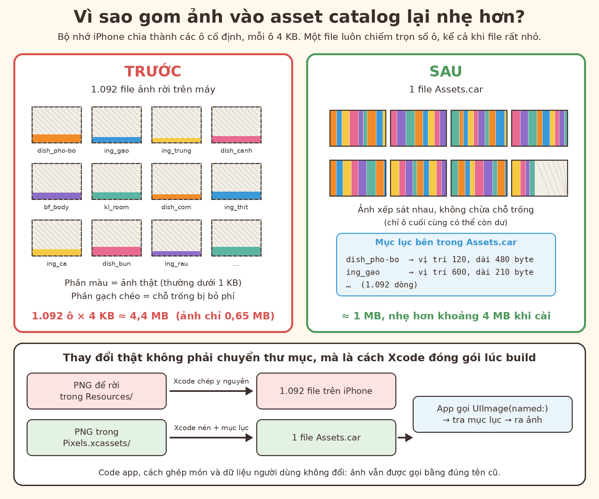

Mình đang làm [Pixel Pantry](https://apps.apple.com/app/id6836859015), một app nhỏ theo dõi tủ lạnh và gợi ý nấu gì, vẽ toàn bộ bằng pixel art. Một hôm mình tự hỏi app nặng bao nhiêu. App Store Connect cho ra hai con số khá lệch nhau:

| Bản 1.0.1 (12) | Dung lượng |
|---|---|
| Tải về (iPhone, đã thinning) | 6,9 MB |
| Cài xong trên máy | **20,1 MB** |

Bản tải về đã nén nên nhỏ hơn bản cài là chuyện bình thường. Nhưng gấp ba lần thì hơi nhiều với một app chỉ có code Swift, ít nhạc và vài font. Bài này kể lại cách mình tìm ra chỗ phình và cách gỡ.

## 1. Lấy số thật từ App Store Connect API

Số thật nằm sẵn trong App Store Connect API, đọc ở đó chính xác hơn là đoán. Với một API key (JWT ES256), chỉ cần hai request:

```bash
# 1. Tìm build bundle của build cần xem
GET /v1/builds/{buildId}?include=buildBundles

# 2. Dung lượng tải về / cài đặt theo từng dòng máy
GET /v1/buildBundles/{bundleId}/buildBundleFileSizes?limit=200
```

Request thứ hai trả về `downloadBytes` và `installBytes` cho từng `deviceModel` (iPhone17,1, iPad14,3…). App mình ra 6,9 / 20,1 MB trên mọi máy.

## 2. Mổ xẻ bản build

Tiếp theo mình build bản Release cho máy thật (`generic/platform=iOS`, không ký) rồi xem bên trong file `.app`:

```bash
du -sh  "Pixel Pantry.app"   # chỗ thật sự chiếm trên đĩa
du -shA "Pixel Pantry.app"   # tổng số byte của các file (apparent size)
find "Pixel Pantry.app" -type f | wc -l
```

Kết quả:

- `du -sh` ra **17 MB**, còn `du -shA` chỉ **13,6 MB**. Cùng một thư mục mà chênh gần 4 MB.
- Trong app có **1.164 file**, trong đó **1.094 là PNG**. Đó là ảnh nguyên liệu, món ăn, đồ nội thất… do script Python tự vẽ, mỗi tấm 16×16 hoặc 32×32 pixel.
- Toàn bộ chỗ PNG đó cộng lại chỉ **0,65 MB**, và phần lớn mỗi file dưới 4 KB.

Hai lệnh `du` chênh nhau ở đâu? Ở các ô 4 KB.

## 3. Ô 4 KB: file nhỏ cỡ nào cũng chiếm trọn một ô

Hệ thống file (APFS trên iPhone) không cấp chỗ theo từng byte mà theo **block**, mỗi block 4.096 byte. Một file 500 byte vẫn được cấp trọn một block 4 KB, phần còn lại bỏ trống. Giống như mỗi món đồ nhỏ xíu đều phải để trong một hộp giày riêng.

Với vài chục file thì không đáng kể. Nhưng với 1.092 file:

```
1.092 file × 4 KB ≈ 4,4 MB chỗ trên máy
dữ liệu ảnh thật       ≈ 0,65 MB
```

Khoảng **3,7 MB là chỗ trống bị bỏ phí**. Còn bản tải từ App Store thì không bị: IPA là file zip, và zip cất các file sát nhau, không có khái niệm block. Vì vậy chỗ phí này chỉ lộ ra **sau khi cài**, và chỉ thấy được trong `installBytes`.



## 4. Cách gỡ: asset catalog

Asset catalog (`.xcassets`) là cách Apple khuyên dùng để chứa ảnh. Điểm quan trọng ở đây không nằm ở việc chuyển thư mục, mà ở **cách Xcode đóng gói lúc build**:

- **PNG để rời** trong một thư mục resource: Xcode chép y nguyên từng file sang app, nên trên máy có 1.092 file.
- **PNG trong `.xcassets`**: Xcode biên dịch tất cả thành **một file `Assets.car`**. Ảnh nằm sát nhau trong file đó, kèm một mục lục ghi tên ảnh nào ở vị trí nào. Một file khoảng 1 MB thì chỉ phí tối đa một ô ở cuối.

Ở runtime, `UIImage(named: "dish_pho-bo")` tra mục lục, đọc đúng đoạn cần rồi trả về ảnh, giống hệt khi ảnh để rời. Code của mình vốn đã gọi ảnh theo tên, nên **không phải sửa dòng Swift nào**.

Mỗi ảnh thành một `imageset` có một file `Contents.json` nhỏ:

```json
{
  "images": [{ "filename": "ing_gao.png", "idiom": "universal", "scale": "1x" }],
  "info": { "author": "xcode", "version": 1 }
}
```

Chi tiết quan trọng với pixel art là `"scale": "1x"`. Nếu để trống, iOS có thể hiểu sai tỉ lệ và trả về ảnh có `size` khác trước. Khi đó những chỗ ghép ảnh bằng code (đặt nguyên liệu 16×16 vào tô 32×32, tô màu…) sẽ bị lệch.

Tất nhiên mình không tạo tay 1.092 thư mục. Một script Python nhỏ chạy sau các script vẽ ảnh: nó chuyển mọi `*.png` mới vào `Pixels.xcassets/<tên>.imageset/` và ghi `Contents.json`. Chạy lại bao nhiêu lần cũng ra cùng kết quả.

## 5. Kết quả

Hai bản Release build cùng cách, trước và sau khi đổi:

| | Trước | Sau |
|---|---|---|
| Chỗ trên đĩa (`du -sh`) | 17 MB | **13 MB** |
| Tổng byte (`du -shA`) | 13,59 MB | 13,90 MB |
| Số file trong app | 1.164 | **72** |
| `Assets.car` | 115 KB | 1.067 KB |
| File thực thi | 8,6 MB | 8,6 MB |

Bản cài nhẹ đi khoảng **4 MB**, tức khoảng 20% cả app. Số file giảm từ 1.164 xuống 72.

Mình cũng cài bản mới đè lên bản cũ có sẵn dữ liệu trên simulator, giống người dùng bấm cập nhật. Sau đó so từng cặp màn hình trước/sau: không mất ảnh nào, pixel vẫn nét, đúng cỡ. Dữ liệu người dùng chỉ lưu **tên** ảnh, mà tên thì giữ nguyên.

## 6. Đánh đổi

Cách này cũng có cái giá, nhưng đều nhỏ:

- **Tổng byte tăng khoảng 300 KB:** `Assets.car` lưu ảnh ở dạng Apple tối ưu cho việc đọc nhanh, nên lớn hơn PNG gốc một chút. Vẫn lời xa so với 4 MB tiết kiệm được.
- **Không đọc ảnh bằng đường dẫn file được nữa:** `Bundle.url(forResource:withExtension: "png")` sẽ không tìm thấy gì. Phải gọi qua `UIImage(named:)`, hoặc `SKTexture(imageNamed:)` nếu dùng SpriteKit.
- **Repo có thêm khoảng 1.100 thư mục nhỏ,** và diff của lần chuyển đầu tiên rất dài.
- **Build lâu hơn một chút** khi ảnh thay đổi, vì Xcode phải biên dịch lại catalog.

## Ghi nhớ

1. **Đo `installBytes`, đừng chỉ nhìn kích thước file tải về.** Chỗ phí vì block chỉ xuất hiện sau khi cài.
2. **`du -sh` và `du -shA` chênh nhiều là dấu hiệu có quá nhiều file nhỏ.**
3. **Hàng trăm file nhỏ thì nên gom lại:** asset catalog cho ảnh, sprite atlas cho SpriteKit, hoặc một file dữ liệu lớn thay cho nhiều file JSON nhỏ.

Còn vài chỗ khác có thể giảm tiếp, như đổi âm thanh hiệu ứng từ WAV sang định dạng nén, cắt bớt font tiếng Nhật, hay build với `-Osize`. Mỗi việc chỉ được vài trăm KB tới 1–2 MB. Phần ô 4 KB là lời nhất, vì gần như không phải đổi gì.
